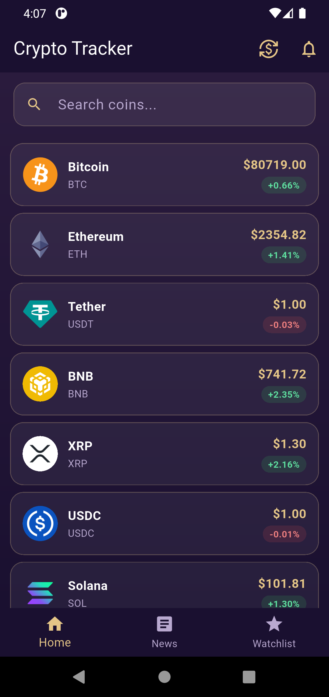
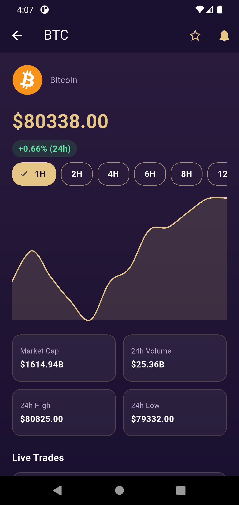
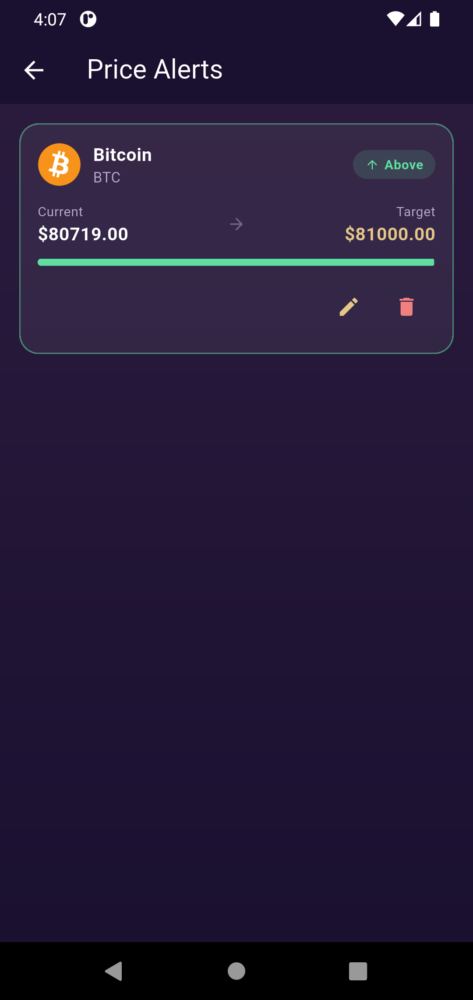

# Crypto Tracker

A feature-rich cryptocurrency tracking app built with Flutter. Tracks live market data, streams real-time trades, delivers crypto news, and lets users set price alerts with push notifications — all wrapped in a custom dark purple/gold UI.

## Features

### Market Data
- Live prices for top 50 cryptocurrencies via the CoinGecko API
- Multi-currency support (USD, EUR, GBP, NGN)
- Pull-to-refresh and tap-to-refresh on the home tab
- Local, case-insensitive search by coin name or symbol
- Price history charts (1H–1W ranges) powered by `fl_chart`

### Live Trade Streaming
- Real-time trade feed per coin via a direct Binance WebSocket connection
- Displays live price, quantity, and timestamp per trade tick
- Gracefully handles coins not listed on Binance

### Price Alerts
- Set "above" or "below" target price alerts on any coin
- Local SQLite persistence with schema versioning/migrations
- Edit and delete existing alerts
- Rich alert cards showing coin image, current vs. target price, a live progress bar, and color-coded direction badges
- Per-coin notification bell icon that reflects whether an active alert exists
- Real local push notifications fire when a tracked price crosses its target

### News Feed
- Aggregated from CoinDesk's RSS feed
- Article images extracted from media tags or inline HTML fallback
- Correct relative timestamps (RFC-822 date parsing)
- Tap to open articles in an external browser

### Favorites / Watchlist
- Add/remove coins to a persistent local watchlist
- Dedicated tab for quick access

## Tech Stack

- **Framework:** Flutter (Dart)
- **State management:** Provider
- **Local persistence:** SQLite via `sqflite`
- **Market data:** CoinGecko REST API
- **Live trades:** Binance WebSocket API
- **News:** CoinDesk RSS via `dart_rss`
- **Charts:** `fl_chart`
- **Other packages:** `html_unescape`, `intl`, `http`, `url_launcher`

## Architecture Notes

- **Repository-style separation**: API/service classes (`crypto_api_service.dart`, `news_api_service.dart`, `live_trade_service.dart`) are isolated from UI, with a `CryptoProvider` managing shared app state.
- **SQLite schema migrations**: the price alerts table has gone through multiple versions (`onUpgrade` handling) to add new columns without breaking existing installs.
- **Defensive JSON parsing**: all model `fromJson` factories use null-safe casts (`as num?`) with fallback defaults, since third-party API responses can omit fields unpredictably.
- **Known tradeoff**: market data is capped at 50 coins on a single page fetch. Pagination to fetch more was attempted and reverted after hitting CoinGecko free-tier rate limits.

## Getting Started

### Prerequisites
- Flutter SDK installed
- An emulator or physical device

### Setup

```bash
git clone https://github.com/boluayeni72/crypto-tracker.git
cd crypto-tracker
flutter pub get
flutter run
```

## Screenshots


